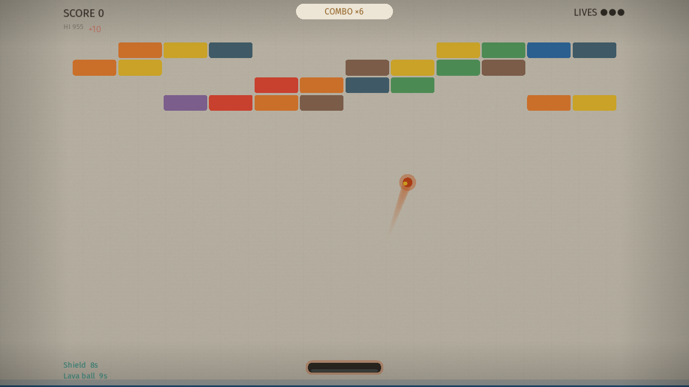

# Brick Press

A juice-heavy arcade brick-breaker, printed flat: smash through twelve seeded brick layouts — punched sieves to giant X formations — while ten kinds of powerups rain from the blocks, TNT topples its neighbours in domino waves, and 10-hit combos ignite a ×2 **FEVER**. The look is pressed paper: five distinct paper stocks that rotate with the levels, earth-ink bricks, no gradients to speak of and **no neon glow anywhere**. The whole game is drawn from a single script onto a fixed 960×640 canvas that stretches to fill any window.



*Mid-run juice: a molten **lava ball** carves through bricks trailing warmth, `COMBO ×6` marks the top-center, and a fresh **Shield** pop lays its floor band under the paddle — active powerup timers sit bottom-left.*

## Run

> **Players**: the Windows **and Linux** builds live under **Releases** — one self-contained `Breakout.exe` (Windows) and `Breakout-linux-x86_64.tar.gz` (Linux: extract, then `./Breakout.x86_64` — no install; needs only glibc 2.28+, i.e. any distro from ~2018 on, and a normal OpenGL 3.3+ / Vulkan driver; both X11 and Wayland work). Saves: `%APPDATA%\Godot\app_userdata\Breakout Godot\` on Windows, `~/.local/share/godot/app_userdata/Breakout Godot/` on Linux — yes, the folder is still named after the old title; renaming it would orphan your scores.

From source, open `project.godot` in **Godot 4.7+** (tested on 4.7.2 stable) and press F5, or:

```
Godot_v4.7.2-stable_win64.exe --path .
```

Boots into the **main menu** (a full-screen title scene — cream paper with drifting ink dust, a decorative brick wall and an opaque paper card with Play / Settings / Leaderboards / Quit, an idle ball bouncing over the paddle); default window 1280×720 (windowed). The game canvas is a fixed 960×640 design space that scales to fill any window size — on windows wider than 3:2 the visible world grows past 960×640 instead of showing letterbox bands, and the background is drawn across the whole visible world.

## Controls

**Main menu** — click **Play** / **Settings** / **Quit** (or **Tab** to move focus, **Space**/**Enter** to activate). The game behind the menu is fully frozen. **Esc** also opens the settings overlay directly from the main menu.

**In game:**

| Input | Action |
|---|---|
| A/D or ← / → | paddle movement — **keyboard-only by design** (~820 px/s; the mouse used to steer it but accidental bumps were worse) |
| Mouse click | launch ball · fire laser (when LASER active) · menu buttons work as usual |
| Space | launch ball (also activates focused menu buttons) |
| **Esc** | **the only menu key** — in game it opens *the* menu (a full freeze: nothing moves, no lives drain) which doubles as settings + quit sheet; from the main menu it opens Settings; it also dismisses the Leaderboards card |
| R | restart (after game over) |
| F | toggle fullscreen |

The field stays clean — no permanent hint bar, no level plate, no background filename in the corner. **Esc**'s sheet carries it all: `PAUSED` title, a run line (`LEVEL 3 · SCORE 1250 · LIVES ●●●`), one control line, the settings controls, and a way out with one click: **Resume · Quit to menu · Quit game** (all three book an unrecorded run before leaving).

## Gameplay

- Blocks: normal (10 pts), tough ×2 (25), tough ×3 (40), **TNT (30, a real domino chain — see below)**, **gold (★, 50 pts, always drops a capsule — positional veins from level 2 on; a coin glint sweeps across them)**, steel (indestructible by ball — dies to laser/explosions/lava only, 5 pts).
- **TNT domino waves**: a bomb hit doesn't just clear a 3×3 patch in one tick anymore — it detonates with a **shockwave ring**, screen shake and a `BOOM! +N` popup; neighbour blocks in the blast radius are chain-killed instantly (**steel included**), neighbouring *bombs* get a lit **fuse (~0.13 s)** and pop on their own beat with their own blast, so a stored line of TNT topples like dominoes. Each deeper wave pays a growing **wave bonus** (`+10 × depth`). If the chain kills the *last* block, the level still clears — the clear check runs on every destruction and every frame, closing the old gap where a wave could empty the field unnoticed.
- **FEVER mode**: a **10-combo** (10 consecutive kills without touching the paddle) ignites **FEVER** — 8 seconds of **×2 scoring** on everything: the field warms with a breathing amber tint, the ball's trail runs warm, and a pulsing `FEVER ×2 Ns` pill counts the clock down under the score plate. Any kill while burning **re-lights the clock to full**; when it finally dies you collect a **+100 parting bonus** with a popup and a last flare. Losing the ball (or the level) snuffs it out.
- **Level clear fanfare**: clearing a level now fires a three-note fanfare with a bright top note, a white flash, a heavier shake, a paddle squash and a white shockwave ring under the paddle, and `LEVEL CLEAR +100` floats up — the moment feels as big as it is.
- **12 level layouts** drawn by seed: rows, checker, pyramid, diamond, columns, clusters, zigzag, arch (converging portal walls), castle (battlement + corner towers), pillars (colonnade + lintel), crossfire (giant X), sieve (punched field).
- 10 powerups, 12 % drop chance: MULTI, EXPAND, SHRINK(bad), SLOW, FAST(bad), LIFE, LASER, STICKY, LAVA, SHIELD — the bad pool only appears from level 2 on.
- **LAVA (L, 10 s)**: the ball turns molten — it **burns straight through** every block, *steel included* (no bounce — it keeps its course, melting a tunnel), and laser bolts also vaporize steel, so the annoying metal rows in later levels finally clear.
- **SHIELD (G, 8 s)**: a floor band paints across the whole bottom — falling balls bounce off it instead of eating a life (a pulsing slate band + soft hum while active).
- **Combos**: every consecutive block killed *without touching the paddle* climbs a `COMBO ×N` chain (pulsing pill top-center, in the slot the level plate used to own); every 4-chain step pays a rising bonus (`+50 × tier`, tier capped at ×5) with a floating popup + jingle. Landing on the paddle resets the chain.
- **Wide-field play**: with expand-stretch the visible world is wider than the 960 design space on any window wider than 3:2 — the **side walls and paddle track the real visible edges**, so the paddle reaches both screen corners and no ball ever hides in a margin.
- **Juice**: fading ball trails (warm-tinted while molten or in FEVER), floating score popups, pickup screen flash, paddle squash + steel-shine bottom edge, **ball squash-&-stretch — the ball elongates along its flight vector the faster it flies**, a slow drifting ink-mote field behind the default paper-gradient sky, bobbing capsules with pulsing halos, a soft vignette over the whole field, and a **heartbeat pulse on the lives readout when it's your last life**. The title scene lives too: drifting ink motes and an idle ball bouncing over the paddle with a ghost trail.
- **Type**: HUD and UI are typeset in **Fira Sans**; the title wears **Archivo Black** — bundled in `fonts/` under the SIL Open Font License.
- **Music**: the pack ships three generated chiptune loops — **Paper Corridor** (`paper_corridor.wav`, 41 s, 140 BPM, E minor), **Starlight Patrol** (`starlight_patrol.wav`, 45 s, 128 BPM, G minor, hymn-like) and **Circuit Sunset** (`circuit_sunset.wav`, 38 s, 152 BPM, A minor, thin buzzy lead). They play in seeded-shuffle order (the theme never repeats back-to-back), autoplay at boot through the **Music** bus (the Settings music slider controls it live), and the playlist grows when you drop more `.ogg/.mp3/.wav` files into `music/`.
- **Local leaderboard**: every finished run lands on the board — game over, Quit to menu / Quit game, **even closing the window mid-run** (the X/Alt-F4 books the pending score before the app dies, so scores can't silently vanish anymore). The best **8** live in the same `user://breakout_high.cfg` (`[default] high` + a `[board]` section, rewritten whole so the two can never drift apart). The main menu's **Leaderboards** button opens a submenu card — the same modal pattern as Settings — listing all saved runs (score · level · date, best in gold), dismissed by Esc or Close. Levels announce themselves too: each new level shows a brief **LEVEL N** title card over the field, and the number then lives quietly in the pause sheet (no permanent HUD plate).
- High score persists to `user://breakout_high.cfg`.

## Backgrounds

**Five ship in the pack** — five visibly distinct paper stocks: **laid cream** `bg1` (fine wire lines), **newsprint** `bg2` (cool grey, print dust), **kraft** `bg3` (deep tan, long mill fibers), **vellum** `bg4` (cloudy ivory), **manila** `bg5` (yellowed folder, lit corner) — printed deterministically by `tools/paint_bgs.py` with numpy + Pillow. **They rotate automatically: every new level wears the next sheet** (`(level − 1) % 5`), so a fresh paper arrives exactly when the level does — no key for it anymore (the old **B** cycle is retired; retired keys are inert). The Settings **Background** picker's item 0 is `(auto — rotates per level)`; picking a named sheet pins that stock until you return to auto. The plain paper-gradient sky is now just the fallback when `backgrounds/` holds no PNGs. Pickers rescan whenever the menu opens, so new images land without a restart.

## Main menu, Settings, Music

**Main menu** — boots to **Play / Settings / Leaderboards / Quit** (Play wears the cobalt spot color; the rest are ink pills with paper-white labels, marigold focus ring). The whole game is frozen behind the menu (the same full-freeze rules as pause); the HUD hint timer only starts on Play. **Play** starts a run (from a finished game, Play = new run). **Settings** opens the settings sheet on top of the menu — **Back to menu** lands back on the menu. **Leaderboards** opens the saved-runs card (Esc/Close dismisses; the two submenus never stack). **Quit** closes the app.

**Settings — same sheet, two faces**: opened in game it's the pause menu (Paused + run info + control line + Resume / Quit to menu / Quit game); opened from the menu it's plain Settings (Back to menu). **Esc** toggles whichever face fits the moment. — Resolution: **1280×720 (720p) / 1920×1080 (1080p) / 2560×1440 (1440p)** — the fixed 960×640 game canvas scales + letterboxes into the window at any size; Fullscreen; **SFX volume** and **Music volume** sliders (0–100, applied live to their audio buses); Background picker. The game stays fully frozen while the sheet is open. Older saved sizes (960×640, 1280×800, …) migrate to 1280×720 on load.

**Music** — the playlist itself is driven by `music/manifest.json`: `"music"` names merge with the folder scan (deduped), `"shuffle"` orders playback with the game's seeded RNG, `"loop"` decides whether playback continues past the last track. An empty folder means a silent boot (no crash).

**What persists** (`user://` on Windows = `%APPDATA%\Godot\app_userdata\Breakout Godot\` — location and guaranteed-writability per the [Godot 4.7 data-paths docs](https://docs.godotengine.org/en/4.7/tutorials/io/data_paths.html)) — `user://breakout_settings.cfg` (section `[settings]`): `sfx_vol`, `music_vol` (linear 0–1), `fullscreen`, `size`, `bg` (`"auto"` or a pinned file name). The game **banks everything on boot and on every close** (X / Alt-F4), on top of saving each control change live — so "closed the game and it reset" is structurally gone. The windowed `size` stays saved even while fullscreen is on (the size selector is disabled meanwhile). Audio runs on three buses: Master + `Music` + `SFX` — the SFX tone pool routes to SFX, the music player to Music; volumes map linear 0–1 → bus dB and 0 = muted. Defaults: SFX 1.0, Music 0.5.
